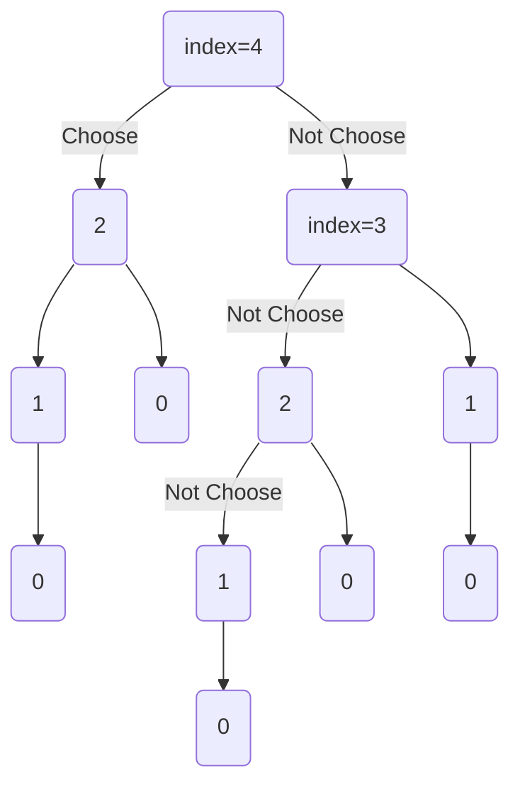
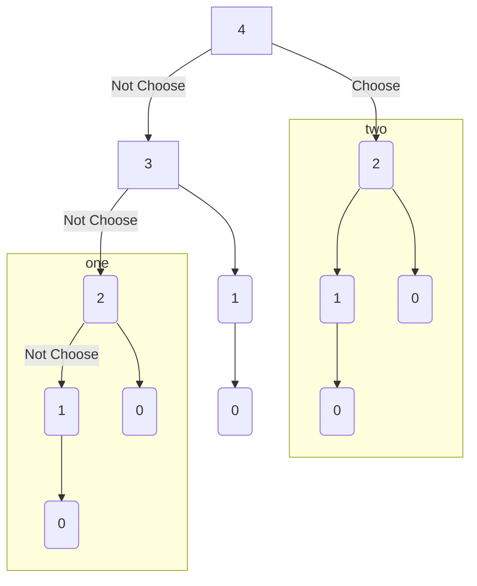
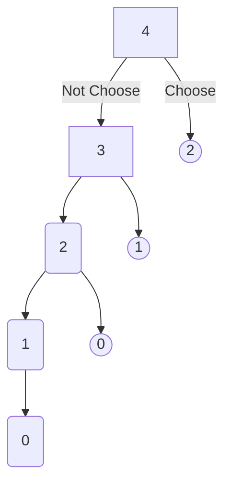
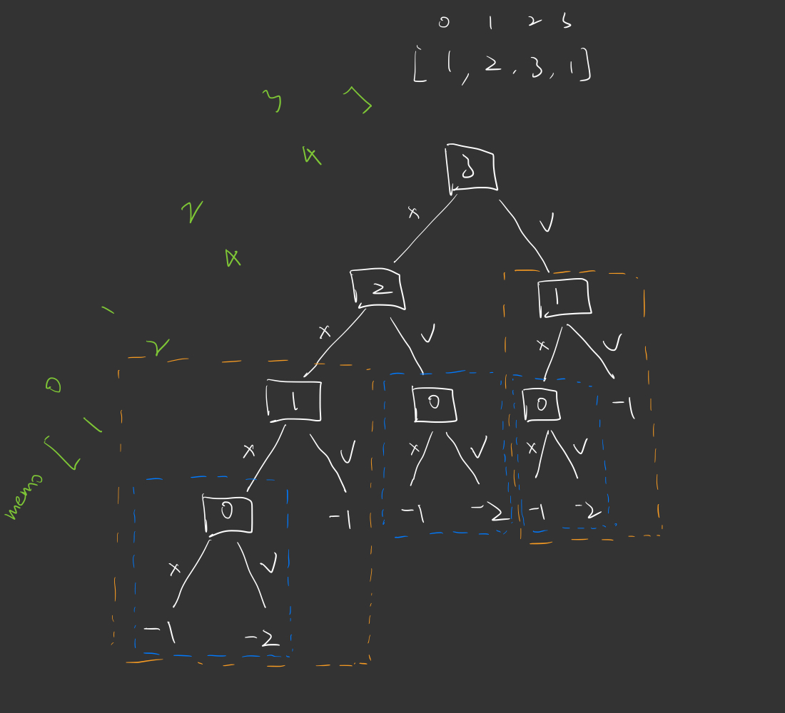

---
tags:
    - Array
    - Dynamic Programming
    - Top Interviews
---

# [198. House Robber](https://leetcode.com/problems/house-robber/)

You are a professional robber planning to rob houses along a street. Each house has a certain amount of money stashed, the only constraint stopping you from robbing each of them is that adjacent houses have security systems connected and **it will automatically contact the police if two adjacent houses were broken into on the same night**.

Given an integer array `nums` representing the amount of money of each house, return *the maximum amount of money you can rob tonight **without alerting the police***.

 

**Example 1:**

```
Input: nums = [1,2,3,1]
Output: 4
Explanation: Rob house 1 (money = 1) and then rob house 3 (money = 3).
Total amount you can rob = 1 + 3 = 4.
```

**Example 2:**

```
Input: nums = [2,7,9,3,1]
Output: 12
Explanation: Rob house 1 (money = 2), rob house 3 (money = 9) and rob house 5 (money = 1).
Total amount you can rob = 2 + 9 + 1 = 12.
```

## Solution



Three questions for the recursive approach:

1. **What is the current decision?**  
   Choose whether to rob house $i$.
2. **What is the subproblem?**  
   Find the maximum amount that can be robbed from the first $i$ houses.
3. **What are the next subproblems?**  
   Consider both choices:

    - Skip house $i$: use the maximum amount from the first $i - 1$ houses.
    - Rob house $i$: add `nums[i]` to the maximum amount from the first $i - 2$ houses.

$$
dfs(i) = max(dfs(i - 1), dfs(i - 2) + nums[i])
$$

When defining a DFS state or a DP state, the state should represent the result calculated from a range of elements rather than from a single element. The accumulated amount is returned by the recursive function instead of being passed as an argument. This makes memoization possible because the result depends only on the current index.

### 1. Recursion

```java
class Solution {
    public int rob(int[] nums) {
        int n = nums.length;
        int index = n - 1;

        int result = dfs(index, nums); // Start from the last house.
        return result;
    }

    // dfs(i) is the maximum amount that can be robbed from nums[0] to nums[i].
    private int dfs(int index, int[] nums){
        if (index < 0){ // Base case: there are no houses left.
            return 0;
        }

        int result = Math.max(dfs(index - 1, nums), dfs(index - 2, nums) + nums[index]);
        return result;
    }
}

// TLE
// TC: O(2^n)
// SC: O(n)
```

### 2. Memoization





Store each recursive result. When the same input appears again, return the saved result instead of recalculating it.

**Recursive search + cached results = memoization**

```java
class Solution {
    public int rob(int[] nums) {
        int n = nums.length;
        int index = n - 1; // Start from the last house.
        int[] memo = new int[n];
        Arrays.fill(memo, -1); // -1 means this state has not been calculated.
        int result = dfs(index, nums, memo);
        return result;
        
    }

    private int dfs(int index, int[] nums, int[] memo){
        if (index < 0){
            return 0;
        }

        if (memo[index] != -1){
            return memo[index];
        }

        int result = Math.max(dfs(index - 1, nums, memo), dfs(index - 2, nums, memo) + nums[index]);
        memo[index] = result;
        return result;

    }
}

// TC: O(n), number of states * time per state
// SC: O(n)
```



### 3. Bottom-up Dynamic Programming

Top-down evaluation uses memoization.

Bottom-up evaluation uses an iterative recurrence.

Translate the recursive solution into a recurrence:

1. Replace `dfs` with the array `f`.
2. Replace recursion with a loop.
3. Convert the recursive base case into the initial DP values.

$$
dfs(i) = max(dfs(i - 1), dfs(i - 2) + nums[i])\\
f[i] = max(f[i-1], f[i-2] + nums[i])\\
f[i + 2] = max(f[i+1], f[i] + nums[i])
$$

```java
class Solution {
    public int rob(int[] nums) {
        int n = nums.length;
        int index = n - 1;
        int[] dp = new int[n + 2];
        // Arrays.fill(dp, -1);
        for (int i = 0; i < n; i++){
            dp[i + 2] = Math.max(dp[i + 1], dp[i] + nums[i]);
        }
        // int result = backtrack(index, n, nums, dp);
        // return result;
        return dp[n + 1];
    }

    // private int backtrack(int index, int n, int[] nums, int[] dp){
    //     if (index < 0){
    //         return 0;
    //     }
    //     if (dp[index] != -1){
    //         return dp[index];
    //     }

    //     int result = Math.max(backtrack(index - 1, n, nums, dp), backtrack(index - 2, n, nums, dp) + nums[index]);
    //     dp[index] = result;
    //     return result;
    // }
}

// TC: O(n)
// SC: O(n)
```

```java
class Solution {
    public int rob(int[] nums) {
        if (nums == null || nums.length == 0){
            return 0;
        }

        if (nums.length == 1){
            return nums[0];
        }

        int[] dp = new int[nums.length];
        dp[0] = nums[0];
        if (nums[0] < nums[1]){
            dp[1] = nums[1];
        }else{
            dp[1] = nums[0];
        }

        for (int i = 2; i < nums.length; i++){
            if (dp[i-1] > dp[i-2] + nums[i]){
                dp[i] = dp[i-1];
            }else{
                dp[i] = dp[i-2] + nums[i];
            }
        }

        return dp[nums.length -1];
    }
}

// TC: O(n)
// SC: O(n)
```

```java
int rob(int* nums, int numsSize){
    if (numsSize == 0){
        return 0;
    }

    if (numsSize == 1){
        return nums[0];
    }
    
    int dp[numsSize];
    dp[0] = nums[0];
    if (nums[1] > nums[0]){
        dp[1] = nums[1];
    }else{
        dp[1] = nums[0];
    }

    for (int i = 2; i < numsSize; i++){
        if (dp[i-1] > dp[i-2] + nums[i]){
            dp[i] = dp[i-1];
        }else{
            dp[i] = dp[i-2] + nums[i];
        }
    }

    int result = dp[numsSize-1];
    return result;

}
```

### 4. Space Optimization

$$
dfs(i) = max(dfs(i - 1), dfs(i - 2) + nums[i])\\
f[i] = max(f[i-1], f[i-2] + nums[i])\\
f[i + 2] = max(f[i+1], f[i] + nums[i])
$$

`current = max(previous, twoBack + nums[i])`

$f_0$ represents the state two positions back, and $f_1$ represents the previous state.

$newF = max(f_1, f_0 + nums[i])$

$f_0 = f_1$

$f_1 = newF$

```java
class Solution {
    public int rob(int[] nums) {
        int n = nums.length;
        // int index = n - 1;
        // int[] dp = new int[n + 2];
        int f0 = 0;
        int f1 = 0;
        // Arrays.fill(dp, -1);
        for (int i = 0; i < n; i++){
            // dp[i + 2] = Math.max(dp[i + 1], dp[i] + nums[i]);
            int new_f = Math.max(f1, f0 + nums[i]);
            f0 = f1;
            f1 = new_f;
        }
        // int result = backtrack(index, n, nums, dp);
        // return result;
        return f1;
    }

    // private int backtrack(int index, int n, int[] nums, int[] dp){
    //     if (index < 0){
    //         return 0;
    //     }
    //     if (dp[index] != -1){
    //         return dp[index];
    //     }

    //     int result = Math.max(backtrack(index - 1, n, nums, dp), backtrack(index - 2, n, nums, dp) + nums[index]);
    //     dp[index] = result;
    //     return result;
    // }
}

// TC: O(n)
// SC: O(1)
```

